

<picture><source media="(prefers-color-scheme: dark)" srcset="assets/hero-dark.svg"></picture>

<picture><source media="(prefers-color-scheme: dark)" srcset="assets/social-l-dark.svg"></picture><a href="https://github.com/zennatha"><picture><source media="(prefers-color-scheme: dark)" srcset="assets/social-1-dark.svg"></picture></a><a href="https://discord.com/"><picture><source media="(prefers-color-scheme: dark)" srcset="assets/social-2-dark.svg"></picture></a><a href="https://instagram.com/"><picture><source media="(prefers-color-scheme: dark)" srcset="assets/social-3-dark.svg"></picture></a><a href="https://wa.me/"><picture><source media="(prefers-color-scheme: dark)" srcset="assets/social-4-dark.svg"></picture></a><a href="mailto:zennatha@gmail.com"><picture><source media="(prefers-color-scheme: dark)" srcset="assets/social-5-dark.svg"></picture></a><picture><source media="(prefers-color-scheme: dark)" srcset="assets/social-r-dark.svg"></picture>

<picture><source media="(prefers-color-scheme: dark)" srcset="assets/about-dark.svg"></picture>

<picture><source media="(prefers-color-scheme: dark)" srcset="assets/stack-dark.svg"></picture>

<a href="https://github.com/zennatha/web-laundry"><picture><source media="(prefers-color-scheme: dark)" srcset="assets/project-web-laundry-dark.svg"></picture></a>&nbsp;<a href="https://github.com/zennatha/belajar-kotlin"><picture><source media="(prefers-color-scheme: dark)" srcset="assets/project-belajar-kotlin-dark.svg"></picture></a>

<a href="https://github.com/zennatha/my-project"><picture><source media="(prefers-color-scheme: dark)" srcset="assets/project-my-project-dark.svg"></picture></a>

<picture><source media="(prefers-color-scheme: dark)" srcset="assets/stats-dark.svg"></picture>

<picture><source media="(prefers-color-scheme: dark)" srcset="assets/streak-dark.svg"></picture>

<picture><source media="(prefers-color-scheme: dark)" srcset="assets/wave-dark.svg"></picture>

<a href="https://github.com/zennatha"><picture><source media="(prefers-color-scheme: dark)" srcset="assets/button-1-dark.svg"></picture></a>&nbsp;&nbsp;<a href="mailto:zennatha@gmail.com"><picture><source media="(prefers-color-scheme: dark)" srcset="assets/button-2-dark.svg"></picture></a>&nbsp;&nbsp;<a href="https://github.com/zennatha?tab=repositories"><picture><source media="(prefers-color-scheme: dark)" srcset="assets/button-3-dark.svg"></picture></a>

<a href="https://metawka.github.io/expressive-profile/?from=zennatha"><picture><source media="(prefers-color-scheme: dark)" srcset="assets/credit-dark.svg"></picture></a>

